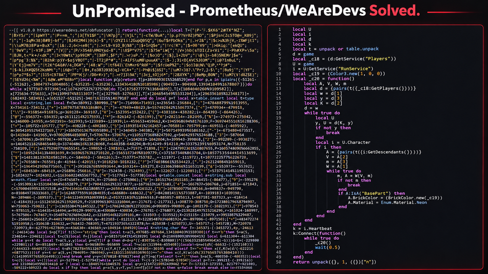

# UnPromised


<p align="center">
  
</p>

<p align="center">
  <a href="https://discord.com/invite/dUCNKkS2Ve"></a>
  &nbsp;&nbsp;
  <a href="https://fireflyprotector.xyz/deobfuscator"></a>
</p>

*by hutaoshusband, a project of FireflyProtector/WBB-Developer Group*


**[+]** 100% Deobfuscation Coverage  
**[+]** Every Preset Supported  
**[+]** Every Protection Layer Defeated  
**[+]** Full Code Reconstruction  


UnPromised is a full static devirtualizer, unobfuscator/deobfuscator and re-optimizer, written in PURE Lua for [WeAreDevs](https://wearedevs.net/obfuscator)/[Prometheus](https://github.com/levno-710/Prometheus) obfuscated Lua and Luau Scripts.

> Note: The [WeAreDevs](https://wearedevs.net/obfuscator) obfuscator is internally upstream pre-v0.3 version of upstream [Prometheus](https://github.com/levno-710/Prometheus) modfied with watermark.

## usage

```sh
# cli: file -> stdout
lua src/cli.lua path/to/obfuscated.lua

# cli: file -> file + print detected layers on stderr
lua src/cli.lua --info path/to/obfuscated.lua clean.lua

# cli: stdin -> stdout
lua src/cli.lua - < path/to/obfuscated.lua > clean.lua
```

As a pure Lua module:

```lua
local A = require("src.frontend.ast")
local D = require("src.pipeline.deobf")
local C = require("src.targets.cls")

local clean_src = D.deobf(obfuscated_src)
local layers = C.detect_layers(A.parse(obfuscated_src))
```

## how?

UnPromised parses Lua 5.1 / Luau source into an AST and iterates a static fixed-point pipeline, that automatically adapts to whatever protection layers are present:

- **layer detection** (`src/targets/cls.lua`): classifies `WrapInFunction`, constant pools, `ConstantArray`, `EncryptStrings`, `ControlFlowFlattening` (Prometheus v0.3 & WeAreDevs), `Vmify` (native, proxy, or flattened), `SplitStrings`, `ProxifyLocals`, `WatermarkCheck`, and `AntiTamper` statically.
- **misc & folding passes** (`src/frontend/fold.lua`, `src/passes/misc.lua`, `src/frontend/scope.lua`): unwraps IIFE wrappers, strips `Watermark`/`WatermarkCheck` and `AntiTamper` guards while keeping live locals intact, collapses `SplitStrings` and `ProxifyLocals`, folds `NumbersToExpressions` (preserving `-0`), expands constant pools, and drops dead pure locals.
- **constant array recovery** (`src/passes/ca.lua`): statically reverses array rotation, Base64/Base85/mixed decoding, and index wrapper functions (both top-level and CFF-flattened).
- **control-flow & CFG recovery** (`src/passes/cff.lua`, `src/passes/cff_cfg.lua`): extracts state-machine dispatchers, resolves upvalue cells and environments, lifts structured `if`/`while`/`repeat`/`for` control flow, eliminates dead temporaries/stores, and inlines single-use registers.
- **string decryption** (`src/passes/enc.lua`): statically recovers the 45-bit / 8-bit LCG parameters and initial state from encryptor blocks or CFF leaves and decrypts every constant string in-place.
- **static VM devirtualization** (`src/passes/vm.lua`, `src/passes/vm_lift.lua`): parses opcode tables, instruction streams, prototypes, constants, and upvalue mappings directly from the VM AST, lifts bytecode back into structured Lua statements and nested closures, and restores method call / global syntax before emitting source (`src/backend/emit.lua`).


## reporting issues / problems

When encountering issues while deobfuscation, check:
- If [WeAreDevs](https://wearedevs.net/obfuscator)/[Prometheus](https://github.com/levno-710/Prometheus) has been updated. If so, then you have to wait for a update of the Deobfuscator.
- If you have the correct environment set up for Lua/Luau with the correct version
- If your script is not native [Prometheus](https://github.com/levno-710/Prometheus)/[WeAreDevs](https://wearedevs.net/obfuscator)
When all of these were checked and the problem is not solved:
- Open a Issue on GitHub CONTAINING your script as a Pastebin/Alternative Source with the error message

What NOT to do:
- Pinging on Discord. This is a Open-Source MIT License Project coded by WBB-Group. We work on multiple projects and would like to focus on this project, when there is time for it. For Discussions about Reverse-Engineering, Obfuscations, Compilers, Programming and Game-Hacking, feel free to join.

## join us / support us

Interested in Reverse Engineering, Obfuscation, Devirtualization, Compiler Development, or Game Hacking? Join our community, check our open-source projects, or support our work!

- **[Discord Server](https://discord.com/invite/dUCNKkS2Ve)**
- **[WBB-Group on GitHub](https://github.com/WBB-Group)**
- **[Support Our Server Costs](https://spenden.pp-h.eu/ce3b1467-c116-4ee0-b6ff-978839e86174)** If you feel really generous, help us cover server and infrastructure costs
- **[Firefly Protector](https://fireflyprotector.xyz)**

All support helps us keep our projects moving forward. ❤️